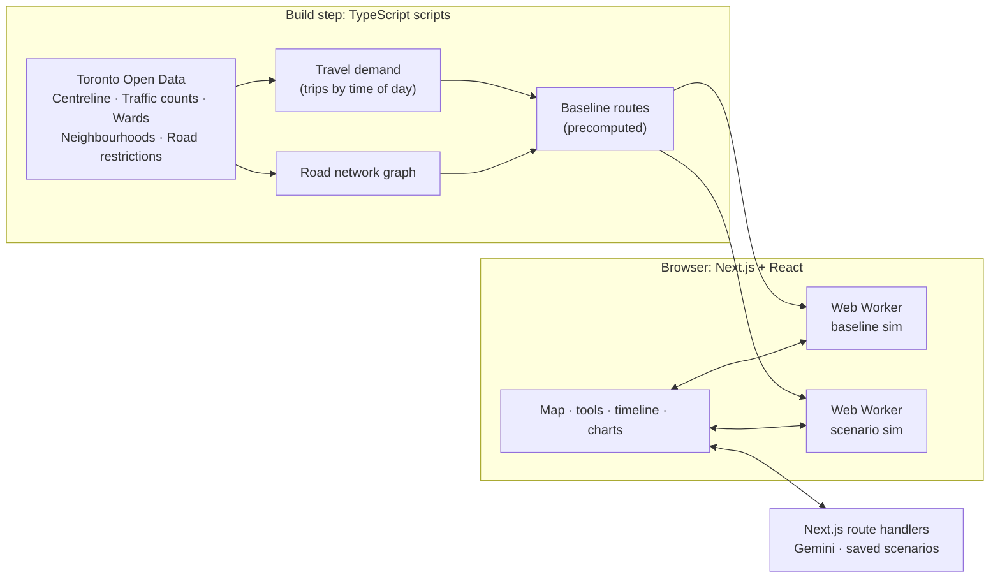

# Toronto Traffic Sandbox

**SimCity for real Toronto streets.** Drop a road closure, a lane reduction, a snowstorm or a Jays game onto a map of the City of Toronto, press play, and watch how traffic responds next to an identical city where nothing changed.

> Built at Hack the Valley 2026 for the **Hack the Valley x School of Cities** civic-tech track.
> Status: 🚧 in development. See [ROADMAP.md](ROADMAP.md) for the full plan and progress.

---

## Why

Toronto votes on **October 26, 2026**, and congestion, construction, bike lanes and the Gardiner are among the most debated issues in the race. Every platform includes a plan for our roads, but the tools that show what those plans would actually do sit with consultants and transportation departments.

Residents get press releases. Journalists get quotes. Community groups get a public meeting.

Toronto Traffic Sandbox gives everyone the same kind of what-if tool that planners use, built on City of Toronto open data and simple enough to use in a browser.

**It tests policies, not candidates.** It does not predict the election, rank candidates or endorse anyone. It makes civic information more useful, accessible and actionable.

## Who it's for

| User | Question they can answer |
|---|---|
| Residents and voters | "If they close this road, what happens to my commute?" |
| Journalists | "Show readers, with numbers, which wards a proposal helps or hurts." |
| Community organizations | "Our neighbourhood absorbs the detour traffic. Here's the evidence." |
| Planners and policymakers | "Which mitigation recovers the most travel time?" |

## What it does

- **Live Toronto map in 2D or 3D:** the whole City of Toronto, with 3D buildings, that tilts between a flat planning view and a 3D city view.
- **Thousands of moving vehicles** routed over the real Toronto road network.
- **Drag-and-drop interventions:**
  - road closure
  - lane reduction
  - construction zone
  - collision
  - event surge (for example, Rogers Centre or Scotiabank Arena letting out)
  - storm or snow (citywide or within a drawn area)
- **Before vs. after:** a baseline city and your scenario run on the same random seed, shown side by side with synced cameras, plus a swipe view and a "difference" heatmap.
- **Time controls:** pick a time window, such as the 7–10 AM rush. Play, pause, run at 1× to 120×, scrub, or jump ahead.
- **SimCity-style results:**
  - average trip time
  - total delay
  - the worst-hit roads
  - CO₂ estimate
  - a **happiness score** for each of Toronto's 25 wards
- **Describe a scenario in plain English** ("close the Gardiner eastbound from Jarvis to the DVP during a snowstorm at 8 AM") and Gemini turns it into a scenario, then writes a plain-language impact summary.
- **Shareable scenarios:** every scenario is a link you can send to a neighbour, a reporter or a councillor's office.

## How it works



**The simulation** is a mesoscopic, agent-based traffic model written in TypeScript. It runs in Web Workers, so there's no simulation server.

1. **Network:** City of Toronto Centreline segments, filtered to expressways, arterials and collectors, become a directed graph. Each edge has a length, a free-flow speed, a lane count and a capacity.
2. **Demand:**
   - Trips are generated between Toronto's 158 neighbourhoods. Origins are weighted by residents and destinations by jobs.
   - Trips are spread across the day using the time-of-day profile from the City's intersection traffic counts.
   - Each simulated vehicle represents a fixed number of real vehicles, and that scale factor is shown in the app.
3. **Congestion:** the travel time on each road segment follows the **BPR function** used in transportation planning:
   `t = t₀ · (1 + 0.15 · (volume / capacity)⁴)`.
   More cars mean slower roads.
4. **Interventions** change the network:
   - A closure removes edges.
   - A lane reduction cuts capacity.
   - Weather lowers free-flow speed and capacity inside an area.
   - An event injects extra trips.

   Affected vehicles reroute, and drivers periodically re-plan using current conditions, so congestion spreads realistically.
5. **Baseline vs. scenario:** both runs use the same seed and demand. Every difference you see is caused by your intervention.

**Happiness** is a 0–100 score per ward, computed from the extra delay residents of that ward experience relative to the baseline, plus penalties for trips that get stuck. The exact formula and every assumption are listed on the in-app **Methodology** page.

## Tech stack

All application and tooling code is TypeScript. There are no hand-written HTML or JavaScript files.

| Area | Tools |
|---|---|
| App framework | Next.js (App Router), React, TypeScript (strict) |
| Map | MapLibre GL via `react-map-gl`, OpenFreeMap vector tiles (3D building extrusions) |
| Vehicle and data layers | deck.gl (`TripsLayer`, `ScatterplotLayer`, `PathLayer`, `GeoJsonLayer`) |
| Simulation | Custom TypeScript engine in Web Workers (`comlink`), `flatbush` spatial index |
| State | Zustand |
| UI | Tailwind CSS, shadcn/ui, Recharts |
| AI | Google Gemini API (`@google/genai`) with structured JSON output |
| Storage (optional) | Tiger Data (Timescale Postgres) for saved scenarios and run metrics |
| Data pipeline | TypeScript scripts run with `tsx`, against the Toronto Open Data CKAN API |
| Quality | Biome (lint + format), Vitest |
| Hosting | Vercel (and/or Vultr) |

## Getting started

> These commands are the target setup. They'll work once the scaffold in Phase 0 of the roadmap lands.

**Requirements:** Node.js 22+ and pnpm.

```sh
pnpm install
cp .env.example .env.local     # add GEMINI_API_KEY (and TIGER_DATABASE_URL if using saved scenarios)
pnpm data:build                # download Toronto Open Data and build the network, demand and baseline
pnpm dev                       # http://localhost:3000
```

| Script | What it does |
|---|---|
| `pnpm dev` | Start the dev server |
| `pnpm build` | Production build |
| `pnpm data:fetch` | Download raw datasets into `data/raw/` (gitignored) |
| `pnpm data:build` | Fetch, then build `public/data/` (network, demand, baseline routes, wards) |
| `pnpm test` | Run Vitest |
| `pnpm check` | Run Biome lint and format checks, plus a TypeScript type-check |

### Environment variables

| Name | Required | Purpose |
|---|---|---|
| `GEMINI_API_KEY` | For AI features | Natural-language scenarios and impact summaries |
| `TIGER_DATABASE_URL` | Optional | Saved scenarios gallery and run metrics |

The core sandbox (map, tools, simulation, before/after, charts) runs with no keys at all.

## Project structure

```
scripts/            TypeScript data pipeline (fetch → build network → build demand → baseline)
data/raw/           downloaded source data (gitignored)
public/data/        generated, browser-ready network, demand, wards, preset scenarios
src/app/            Next.js routes and API route handlers (Gemini, scenarios)
src/components/     map, tool palette, timeline, results panel, charts
src/sim/            simulation engine, routing, BPR, interventions, metrics, happiness, workers
src/store/          Zustand stores
src/lib/            shared types, geo helpers, scenario encoding
```

## Data sources

All data is from **City of Toronto Open Data** under the [Open Government Licence – Toronto](https://open.toronto.ca/open-data-license/), unless noted.

| Dataset | Used for |
|---|---|
| Toronto Centreline (TCL) | Road network: geometry, road class, one-way direction |
| Traffic volumes at intersections (turning movement counts) | Time-of-day demand profile, baseline calibration |
| City Wards (25-ward model) | Per-ward results and happiness |
| Neighbourhoods (158) and Neighbourhood Profiles (2021 Census) | Trip origins (population) |
| Toronto Employment Survey | Trip destinations (jobs) |
| Road Restrictions | Real current closures, loadable as scenarios |
| Cycling Network | Bike-lane scenarios |
| © OpenStreetMap contributors, via OpenFreeMap | Basemap tiles and 3D building heights |

## Limitations

This is a hackathon prototype, not a forecasting tool. Please read results as **directional, not exact**.

- Demand is synthesized from census, employment and count data, not from a calibrated regional travel model.
- Local residential streets are excluded for performance, and intersections are modelled through segment capacity, not individual signals.
- Weather effects use published average speed and capacity reductions.
- Transit, cyclists and pedestrians are not simulated yet. Only cars are.
- Results are only as good as the open data behind them. Every assumption is listed on the Methodology page.

## Neutrality

Preset scenarios describe **policies and events**, never candidates or parties. The app makes no predictions about the election and produces no recommendations about how to vote.

## Team

Built by a team of three at Hack the Valley 2026.

## License

MIT
