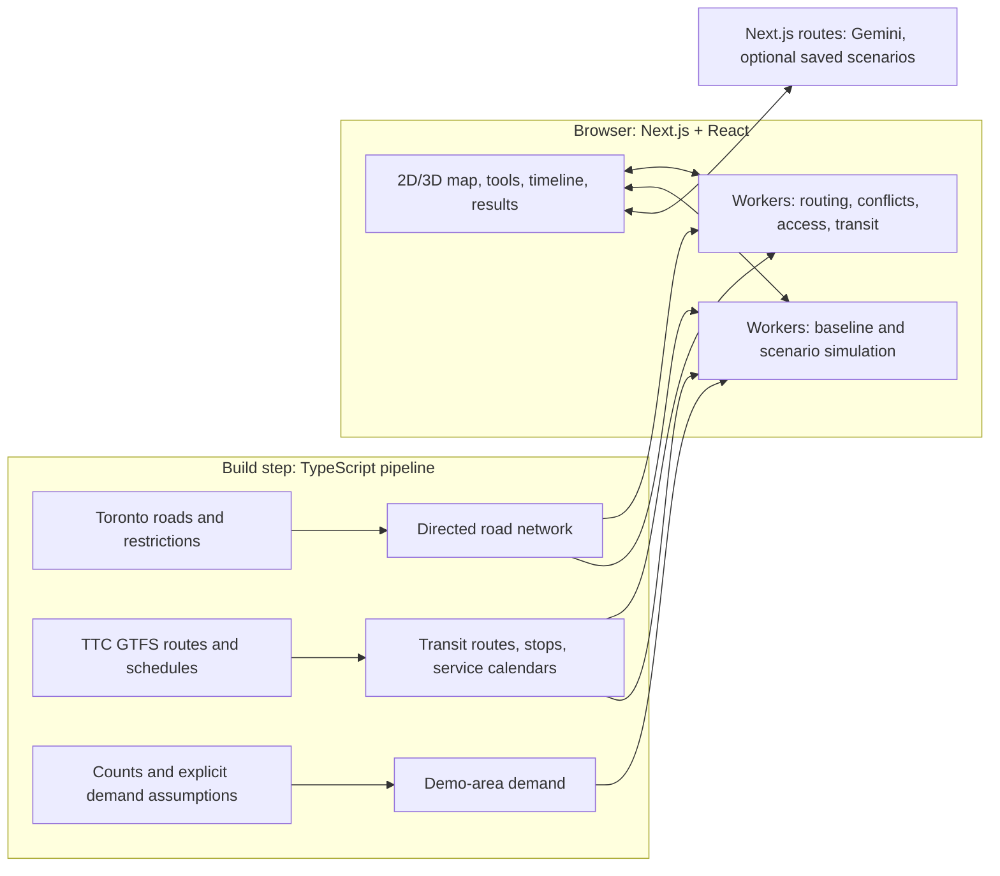

# Toronto Traffic Sandbox

**Test how Toronto's road closures, construction, and events affect the people moving through the city.** Create a scenario, inspect car and TTC impacts, compare alternatives, and share the result on an interactive 2D or 3D map.

> Planned for Hack the Valley 2026 and the **Hack the Valley x School of Cities** civic-tech track.
> **Status: typical citywide traffic, 2D/3D views, and a draggable disruption toolbox.** The current app combines animated traffic estimates and time controls with closures, events, accidents, and construction. Saved full closures hide traffic on their matching segments. Rerouting, queues, event demand, sharing, and TTC analysis remain planned.
> This README reflects the revised product direction. [ROADMAP.md](ROADMAP.md) contains the earlier implementation plan and still needs to be reconciled with this scope, especially TTC support and prototype priorities.

## Why

A construction closure, a street festival, and a bus diversion can each look manageable on their own. Together, they may block an alternative route, interrupt access to a venue, or move disruption onto another neighbourhood.

Toronto Traffic Sandbox will help city staff, event organizers, and the public explore those interactions before a plan is implemented. The shared question is: **what changes, who is affected, and which alternative reduces the disruption?**

For the School of Cities track, the civic problem is how Toronto coordinates street disruption and maintains access during construction and events. The prototype will use Toronto urban data to make those decisions more understandable and actionable in the context of the 2026 municipal election and beyond.

**It tests plans and policies, not candidates.** Scenarios and explanations will remain non-partisan.

## Who it's for

| User | Question they can explore | Useful outputs |
|---|---|---|
| City officials and planners | "Do these construction closures block each other's detours?" | Conflicting diversions, affected TTC routes, access checks, comparison of alternative timings or closures |
| Event organizers | "Can people reach and leave this venue with these streets closed?" | Venue access, nearby closure conflicts, affected stops, traffic pressure points under stated attendance assumptions |
| Residents and public users | "What does this plan change for my journey?" | Selected car or transit journey comparisons, affected services, explanations, shareable scenarios |
| Journalists and community organizations | "What changes if one road stays open?" | A reproducible comparison with visible inputs, affected connections, and assumptions |

## One sandbox, three starting points

All users will work with the same map, scenario model, analysis, and comparison tools.

- **Plan construction:** select road segments, closure or lane-reduction details, and start/end times.
- **Plan an event:** select a venue or event footprint, closure times, and optional attendance and arrival/departure assumptions.
- **Explore an impact:** open a preset or shared scenario, select places or journeys, and inspect what changes.

The common workflow is **create → inspect → compare → share**. Manual tools will work independently of AI. A natural-language prompt will offer another way to create and modify scenarios, with a preview of the interpreted roads, times, and changes before applying them.

## First prototype

The initial demo will cover **one well-developed Toronto area**, using real road and TTC geography. Citywide mapping is the longer-term setting; citywide simulation is a performance and data goal, not a requirement for the first demo.

### Available now

- Citywide traffic ribbons for 42,987 Toronto Centreline segments, with directional white streaks and congestion colours estimated from historical midblock/intersection counts, inferred daily volumes, time-of-day profiles, assumed capacities, and BPR speeds. These are typical conditions rather than live sensor readings. Local streets appear from zoom 14.5. The collapsible legend explains the sources and assumptions.
- A glass timeline with a compact date button beside the clock, a calendar opening above the bar, Current time mode using Toronto's date and time, accelerated playback, pause, and a daily traffic curve. The selected date automatically chooses the weekday/weekend profile; accelerated playback advances the date at midnight. Choosing a date leaves Current time mode while retaining the time of day, and Current time restores today. The calendar supports month/year navigation, Today, keyboard arrows, Escape, and outside dismissal; a calendar icon stays available when the bar is minimized. `?date=2026-10-19&time=17:30&speed=5m` opens a dated demo; legacy `?day=weekday` selects the next matching date. Dates select typical-day estimates rather than historical observations, holiday adjustments, or seasonal demand factors. Disruption schedules still use their existing time-of-day logic without calendar-date filtering. Click a traffic ribbon for its baseline volume, speed, capacity assumptions, source information, and daily chart. Traffic panels hide during disruption placement/editing. Reduced motion freezes streaks; pausing freezes playback and streaks. Hidden tabs stop traffic animation.
- Saved full closures of any road disruption type hide that segment's ribbons and remove it from the displayed vehicle estimate. All 5,659 downtown toolbox segment IDs match the citywide traffic data. Drafts do not change traffic until saved; moving, reopening, or removing a restriction restores the old segment unless another full restriction remains. Stored schedules remain metadata and do not filter the typical-day clock. Lane reductions and event attendance do not change traffic yet; removed vehicles are not reassigned elsewhere.
- A full-screen Toronto map with pan, zoom, attribution, and a small 2D/3D toggle.
- Automatic overlay-aware building transparency in tilted views. A GPU capture of the basemap beneath native 3D objects is blended through foreground surfaces only along narrow road corridors in a soft central viewing area, with a matching depth-tested traffic pass to keep ribbons readable. Buildings, facades, landmarks, and trees retain their native rendering elsewhere. While placing a disruption or adjusting an endpoint, an 88 px soft cursor area also reveals the ground beneath obstructing objects and fades away after release or cancellation. Passive fading is softer than cursor clearing and leaves the skyline and viewport edges solid. Strength varies with pitch; flat views skip the effect. Both renderers use the same compositor, road geometry follows the traffic viewport and street zoom thresholds, and reduced motion removes the cursor fade animation. Native rendering stays available if the compositor cannot initialize. This is an approximation of overlay-aware transparency, rather than a change to each building's material; it does not replace detailed buildings or clear the entire skyline.
- A fixed left-side rail with matching glass toolbox and weather buttons. Only one panel opens at a time, beside the rail, so both icons remain accessible. Weather offers Current Toronto and Manual modes, independent 0–100% rain and snow sliders, mixed precipitation, intensity labels, and a Clear weather reset. Current time starts with weather sync; changing the date or selecting playback freezes the last weather as a manual scenario. Slider changes and Clear weather also switch to Manual. Returning from playback to Current time resumes sync. A separate canvas draws up to 140 rain streaks and 80 snowflakes at 30 fps, scaled down on smaller screens, without changing basemap styles or recreating the map. Camera pitch gradually introduces depth layers, longer/brighter diagonal rain streaks, larger foreground snowflakes, and a soft storm haze, while flat views preserve the original rendering. Above 85% rain in tilted views, occasional pure-white lightning bolts, layered white radiance, and bright white map illumination appear, with the first strike after roughly one to two seconds and later strikes at intervals of at least eight seconds. Strikes vary between single pulses and two separated return-stroke pulses on the same bolt, lasting under a second. The white halo uses layered strokes without a blur filter. Lowering intensity, flattening the view, or hiding the tab clears lightning. Hidden tabs and reduced-motion preferences stop all precipitation animation and lightning. Current Toronto weather is a model estimate for a downtown reference point, with source, data timestamp, physical rain/snow rates, refresh, and retry controls. Failed refreshes retain the last values. Weather also lowers assumed traffic speed and capacity as precipitation increases, updating ribbon motion, congestion colours, road statistics, and detour travel costs with the same deterministic model.
- A left-side toolbox with four draggable tools: road closure, event, accident, and construction. Events can be placed at any location inside Toronto; street disruptions snap to the closest downtown road on screen. Each type has its own icon, colour, and editable preview. Name an item, optionally set a schedule in Toronto local time, estimate event attendance, or choose a full closure/lane reduction. Attendance stays unspecified until entered. Applied markers can be dragged to propose a new location, clicked to edit, or removed from the preview. Moving an existing item preserves its identity and details; changes apply only when saved. Keyboard users can activate a tool, move the map with arrow keys, and press Enter to preview the location at the centre. Escape cancels placement.
- Road closures, accidents, and construction previews have two draggable endpoint handles. Resize within a segment or trace the cursor across connected downtown blocks. The endpoint snaps onto the street under the cursor from the latest intersection; switching outgoing streets replaces only the unfinished tail, while completed blocks retain their order and road bends. Passing another intersection advances this anchor. Tracing back shortens the selection. Snapping can resume on an outgoing street without returning to the moving handle, and no global shortest-path search changes earlier blocks. The preview reports the affected length and moves the model to the selected stretch's midpoint. Handles support touch and arrow keys (Shift for larger steps); invalid drops, pointer cancellation, and Escape during a drag restore the previous extent. Click a saved restriction to edit its endpoints, then save or cancel. Selection is bounded to 24 segments and 3 km, with a minimum 5 m extent. Events retain point placement. Exact endpoints are saved and drawn, while current traffic estimates still apply to whole touched segments. Moving the main icon onto a road starts a new full-segment extent.
- Custom Three.js scenes for all four tools in close 3D views: striped closure barricades, stopped cars with amber warning beacons, a cone-lined excavator work zone, and an event stage with four cyan/violet concert beams sweeping into the sky. Road scenes follow the local street direction. Models appear from zoom 14.5 with at least 20° pitch; flat and wider views retain icons. The icons remain accessible editing and dragging handles above the scenes. Models use a modest display scale for readability and are illustrative, rather than surveyed dimensions. Stage beams are visual effects and do not illuminate basemap buildings. Reduced-motion preferences freeze beams and warning lights. Both Mapbox and MapLibre use the same scenes; Three.js loads after the first item is previewed, and removed scenes release GPU resources. Animation stops when the tab is hidden or no animated models are in view. If the model renderer cannot load, icon placement remains available.
- Toronto-only navigation using the City's official Regional Municipal Boundary: camera bounds, a city-scale minimum zoom, and a polygon check that keeps the map centre inside Toronto. Surrounding streets gradually fade into a sky-blue background beyond the boundary, without a hard outline. Both renderers share the fade and apply the navigation restriction in 2D and 3D.
- **Mapbox Standard preview** when `NEXT_PUBLIC_MAPBOX_ACCESS_TOKEN` is configured: simulator-driven lighting and built-in 3D buildings, facades, landmarks, and trees where available. The 3D button enables these objects and tilts the camera; 2D hides them and returns to a flat view.
- A light sky-blue sandbox theme: cool off-white land, brighter blue water, pale blue buildings, and soft mint greenspace. Business/POI labels, landmark icons, and indoor labels are hidden; street, place, and transit labels remain visible. The palette and Mapbox settings live in `src/lib/map-theme.ts`.
- Automatic day/night lighting that follows Toronto's real sunrise and sunset for the selected simulation date, with roughly 75-minute dawn and dusk ramps instead of a hard switch. Map colours blend gradually, Mapbox steps through its night, dawn, day and dusk light presets, the glass controls fade between themes, and disruption-model lighting dims with the daylight. Open `?date=2026-10-17&time=18:28` to preview autumn dusk.
- Liquid-glass controls across the toolbox, closure previews, map-view switch, notifications, and zoom/compass controls: translucent blue-white surfaces, backdrop blur, white edge highlights, and subtle SVG edge refraction where supported. Text stays sharp, with opaque fallbacks and reduced-transparency/motion support. The shared SVG filter lives in `src/components/glass-filter.tsx` and material tokens in `src/app/globals.css`.
- Glass uses 45% tint on small controls, 64% on text panels, and 8–10 px CSS blur. The toolbox, 2D/3D switch, and zoom/compass controls share the lazily loaded `liquid-glass-react` optical layer in `src/components/glass-surface.tsx`; interactive controls remain separate from the effect. Both map renderers use the same accessible controls. Reduced-transparency or higher-contrast preferences retain the opaque CSS material. The library's displacement rendering varies by browser.
- **MapLibre/OpenFreeMap fallback** when no token is configured: the existing coloured map remains available with height-based building extrusions. A small notice explains how to enable Mapbox.
- Explicit container sizing, resize handling, and loading/error feedback.

The active renderer is loaded separately, so the fallback does not initialize Mapbox or make Mapbox map requests. Basemap tiles require an internet connection and a WebGL-capable browser. The current page does not wait for road-data downloads, scenario restoration, or simulation overlays.

Mapbox Standard supplies its own building geometry, materials, and lighting. Detail varies by location; the preview does not promise photographic or landmark coverage throughout Toronto. Mapbox imagery and services retain their own attribution and usage requirements.

Current weather uses [Open-Meteo](https://open-meteo.com/en/docs) through `/api/weather`, fixed at 43.6532, -79.3832. Server caching and in-flight request sharing limit provider calls to once per 15 minutes per server instance; clients poll at that interval while visible, resume when visible again, and retry when reconnected. No API key is required for this prototype. Current rain plus showers are in millimetres and snowfall in centimetres over the returned interval, so amounts are converted to hourly rates using `3600 / interval`. Rain visual anchors are 0, 0.1, 0.5, 2.5, 7.5, and 15 mm/h mapped to 0, 8, 20, 45, 75, and 100%; snow anchors are 0, 0.1, 0.5, 1, 2.5, and 5 cm/h mapped to 0, 10, 30, 50, 80, and 100%. Values interpolate between anchors and saturate at 100%. These are illustrative visual scales, not calibrated physical severity thresholds. Current updates blend in the precipitation renderer without per-frame React updates. Lightning continues to follow rain intensity above 85% in both modes, independent of provider thunderstorm codes. Missing measurements, unexpected units, and old timestamps fail without substituting clear skies. Manual overrides and clock changes cancel outstanding client requests and guard against late responses.

### Weather and traffic assumptions

Both Current Toronto and Manual weather now affect traffic estimates. Current mode uses the provider's physical rain (mm/h) and snowfall (cm/h) rates directly. Manual sliders invert the visual anchors above into the same units. Clear weather restores the original model. Ribbon colours blend continuously between the existing congestion thresholds (0%, 50%, 75%, and 92% of capacity), so smaller changes within a category are visible. Normal ribbons, disruption highlights, and road-detail indicators share this scale; category labels retain their existing thresholds. Colour calculations use the existing state refresh and rendering layers. Trip demand and historical daily counts stay unchanged; lower capacity increases volume/capacity ratios and the existing BPR calculation lowers speed. Slower travel increases the displayed estimate of vehicles present on roads without inventing additional trips.

The curves in `src/lib/traffic/weather.ts` are prototype assumptions informed by [FHWA's road-weather mobility research summary](https://ops.fhwa.dot.gov/weather/roadimpact.htm), not coefficients fitted to Toronto observations. FHWA reports arterial speed reductions of 10–25% on wet pavement and 30–40% on snowy/slushy pavement, with saturation flow reductions of 2–21%. Freeway findings include heavy-rain free-flow speed reductions of 6–17%, capacity reductions of 10–30%, and heavy-snow capacity reductions of 12–27%. Arterial average-speed findings are used as guidance for an uncongested-speed proxy; they are not measurements of that model parameter. These studies span different places, weather and road surfaces; they do not prescribe the following intensity curves.

Each table entry is **uncongested-speed reduction / capacity reduction**. Values interpolate linearly between rows and saturate at the last row. Expressway ramps use expressway factors; other road classes use street factors, with local/collector behaviour an explicit extrapolation from arterial findings.

| Rain (mm/h) | Expressways | City streets |
|---|---|---|
| 0 | 0% / 0% | 0% / 0% |
| 0.5 | 2% / 4% | 4% / 2% |
| 2.5 | 5% / 8% | 10% / 5% |
| 7.5 | 9% / 14% | 16% / 10% |
| 15+ | 12% / 20% | 20% / 15% |

| Snowfall (cm/h, depth rather than liquid equivalent) | Expressways | City streets |
|---|---|---|
| 0 | 0% / 0% | 0% / 0% |
| 0.1 | 3% / 2% | 4% / 2% |
| 0.5 | 8% / 6% | 10% / 5% |
| 1 | 15% / 12% | 20% / 10% |
| 2.5 | 23% / 20% | 30% / 16% |
| 5+ | 30% / 25% | 35% / 20% |

Mixed precipitation takes the stronger reduction for each parameter rather than multiplying rain and snow penalties. Lane reductions then multiply weather-adjusted capacity once. Full closures stay closed. Before/After comparisons use the same weather on both sides. Road details and their daily baseline chart use the selected weather, with the chart excluding disruptions and holding those conditions constant throughout the day. Detour requests, cache keys, legal route costs, and optional Gemini context include weather; route times are already adjusted before reaching Gemini. Slider changes debounce diversion requests, invalidate plans from different weather, and update the existing traffic overlay without rebuilding geometry or adding animation layers. Factors are cached per weather state and road family.

This does not model precipitation accumulation, ice, snow clearing, flooding, visibility, cancellations, mode shifts, dynamic queues, or a calibrated weather forecast of traffic. Toronto counts contain mixed observation conditions; treating them as the reference is an approximation and may already include wet-weather effects. A local fit would require dated raw traffic observations matched to weather and pavement/maintenance conditions. No new Toronto traffic observations or seasonality factors are claimed.

The fallback uses OpenFreeMap/OpenStreetMap building heights, with a six-metre visual fallback where height is missing. Its pale-to-sky-blue building colours reflect height, not traffic conditions or measured facade colours. MapLibre's worker URL remains explicitly configured to avoid the earlier worker-loading failure.

The traffic UI and its active deck.gl adapter load after the basemap is ready, followed by `public/data/traffic.json` (about 15.4 MB raw or 3.29 MB with gzip). Road geometry retains seven decimal places and removes consecutive duplicate points during data preparation, avoiding metre-rounding kinks without adding runtime curve calculations or extra vertices. Rebuild the full traffic file with `corepack pnpm data:traffic`, or refresh only geometry from the cached Centreline with `corepack pnpm data:traffic-geometry`; the latter preserves traffic estimates and rejects unexpected extra source vertices. Raw City downloads are cached in ignored `data/raw/`. Mapbox uses `@deck.gl/mapbox`; MapLibre uses `@deck.gl/maplibre` without modifying private camera properties. Native Mapbox buildings and the existing MapLibre extrusions remain enabled by the 3D toggle. The PR's alternative see-through building renderer remains in `src/components/traffic/building-layers.ts` for future work and is not loaded by the active traffic overlay.

The bundled Toronto Centreline extract loads only when the toolbox is opened. Street placement covers the downtown extract and requires street-level zoom; the toolbox includes a Show area shortcut. Events do not require road data. Street restrictions store ordered road sections and endpoint fractions; traffic calculations currently approximate these with whole selected segments, and lane-reduction inputs do not infer actual lane counts. Disruptions remain in memory for the current session. Event footprints, detailed partial-segment traffic modelling, and persistence remain planned. Existing illustrative traffic values in the road file are not displayed by the tools. The shared scenario model lives in `src/lib/disruptions.ts`, road-selection geometry in `src/lib/road-extent.ts`, and the controller in `src/components/disruption-toolbox.tsx`. `src/components/map-workspace.tsx` connects saved restrictions and interaction state to traffic. Everything below describes the intended product rather than features available today.

### Core analysis and interaction

- Place multiple road closures or lane reductions with explicit start/end times.
- Calculate car diversions and identify when one closure blocks another's alternative route.
- Check whether selected destinations remain reachable within the modeled network.
- Identify bus and streetcar routes intersecting the affected streets and stops that may lose service under the scenario.
- Click a warning to highlight the responsible closures, affected connections, supporting data, and assumptions.
- Compare a baseline with a scenario, or compare two alternatives such as reopening a road or changing a closure's timing.
- Share a scenario that restores its inputs and assumptions, so another user can inspect the same plan.

### Map and playback

- Start in **2D planning view** for selecting segments, drawing event footprints, and inspecting routes.
- Add a **3D exploration toggle** using a tilted camera and extruded buildings. Both views will use the same scenario and analysis.
- Keep closures, detours, TTC routes, and warnings readable in either view; building detail will depend on tile coverage and available heights.
- Provide time selection and playback to inspect when closures overlap. Vehicle animation will be labeled as schedule-based or simulated, depending on its source.
- Build the 2D closure workflow first, then add 3D and animation early enough to check performance on team laptops.

### Traffic and TTC simulation target

Alongside the core network checks, aim to demonstrate traffic flows and **a small number of affected surface-transit routes** in the demo area. Congestion estimation must not block a working closure-comparison demo.

- **Cars:** model trips using explicit demand assumptions, road capacities, and routing rules; show estimated changes in travel time and delay when supported by the model.
- **Buses:** use published schedules as a starting point, test candidate diversions, and check road restrictions and suitability where data is available.
- **Streetcars:** keep candidate diversions on connected tracks. Where no usable track diversion exists, allow an explicitly hypothetical replacement-bus service.
- **Transit/traffic interaction:** estimate delays for buses and mixed-traffic streetcars from modeled road conditions, with separate assumptions for stops, dwell time, and service frequency.
- **Selected transit journeys:** compare access and estimated journey times for the supported routes and services, including waiting and transfers where implemented.

The first prototype will not model passenger crowding, fleet allocation, or systemwide service reliability. Subway service changes will require an explicit transit intervention; nearby road congestion will not automatically slow underground trains.

## Example demo

1. A city staff member places a construction closure in the demo area.
2. An event organizer adds a nearby event footprint and overlapping street closures.
3. The sandbox highlights a blocked diversion, an affected TTC route, and changes to selected journeys or venue access.
4. Clicking a warning reveals which connections caused the conflict and which assumptions affect the result.
5. The user reopens one segment or changes a closure's timing and compares the alternatives.
6. A resident opens the shared scenario and inspects their journey in 2D or 3D.

## Results and explanations

Results will distinguish **network checks**, **schedule-based calculations**, and **simulation estimates**.

| Result | Basis |
|---|---|
| Blocked diversions and disconnected destinations | Connectivity and routing in the modeled road network |
| Affected TTC routes and stops | Route/stop matching against closures, checked against service assumptions |
| Additional route distance | Calculated baseline and alternative paths |
| Estimated car or transit journey time | Routing costs, schedules, and any stated traffic, waiting, or dwell assumptions |
| Traffic pressure points and estimated delay | Modeled demand, capacities, and rerouting behavior |

Warnings will explain their reasoning rather than only showing a score. Concrete changes to journeys, transit service, and access will take priority over an abstract ward happiness metric.

Gemini will translate prompts into validated scenario inputs and explain calculated results. It will not supply unsupported traffic figures or treat a generated diversion as a verified operational plan.

## Planned architecture



1. **Road network:** build a directed graph from Toronto Centreline data, checking connectivity, driving directions, and available turn restrictions in the demo area. Document any supplementary data or manual corrections.
2. **Transit network:** import GTFS routes, stops, trips, stop times, and service calendars. Match relevant surface routes to roads or tracks and validate the demo routes before using them for closure analysis.
3. **Scenario analysis:** apply time-bounded restrictions, calculate candidate diversions, and check access and conflicts. A route intersecting a closure will trigger investigation; the analysis must consider the actual restriction and service details before claiming service is blocked.
4. **Simulation:** target a TypeScript mesoscopic model in Web Workers, with precomputed baseline routes and incremental rerouting. BPR link costs are a proposed congestion approximation; queue storage, spillback, and transit stop behavior need explicit modeling and validation.
5. **Comparison:** use the same seed, starting demand, data version, and assumptions for comparable runs. Event demand or service changes are explicit scenario differences. Compare common trips separately from added event trips so totals remain interpretable.
6. **Explanation and sharing:** preserve scenario inputs and data/model versions in shared results. A planned Methodology page will document sources, assumptions, validation, and known gaps.

## Planned tech stack

Application and tooling code will use TypeScript, with TSX for React components.

| Area | Tools |
|---|---|
| App framework | Next.js App Router, React, TypeScript strict mode |
| Map | Mapbox GL JS with Standard; MapLibre GL and OpenFreeMap as the token-free fallback |
| Vehicle and data layers | deck.gl for paths, vehicles, event areas, and impact overlays |
| Analysis and simulation | TypeScript Web Workers, `comlink`, `flatbush`; evaluate model feasibility on the demo area |
| State | Zustand |
| UI | Tailwind CSS, shadcn/ui, Recharts |
| AI | Google Gemini API with structured output, validated with `zod` through server routes |
| Sharing | Encoded scenario URLs; optional storage for larger scenarios or saved results |
| Storage, optional | Tiger Data / Timescale Postgres |
| Data pipeline | TypeScript scripts run with `tsx`, Toronto Open Data and GTFS processing |
| Quality | Biome, TypeScript checks, Vitest for routing and model behavior |
| Hosting | Vercel initially; Vultr optional |

The 2D/3D view will share one map implementation. A custom photorealistic city engine is outside the prototype scope.

## Planned data sources

Toronto datasets will be sourced from [City of Toronto Open Data](https://open.toronto.ca/) under their applicable licences, including the [Open Government Licence – Toronto](https://open.toronto.ca/open-data-license/) where specified. Resource versions, coverage, and suitability still need verification for the chosen demo area.

| Dataset | Intended use and checks |
|---|---|
| Toronto Centreline | Road geometry, names, connectivity, direction attributes; verify usable topology and restrictions |
| Road Restrictions | Existing restrictions as context; distinguish lane occupations from full closures and record retrieval time |
| [TTC routes and schedules / GTFS](https://open.toronto.ca/dataset/merged-gtfs-ttc-routes-and-schedules/) | Routes, stops, scheduled trips, and service calendars; validate relevant surface routes and track connectivity |
| Intersection turning-movement counts | Ground demand assumptions and assess baseline flows where coverage supports comparison |
| Midblock speed and volume counts | Additional baseline checks where suitable measurements exist |
| Neighbourhood population and employment data | Optional inputs to synthetic travel demand; document gaps and fallback weights |
| City boundaries, wards, and neighbourhoods | Geographic context and impact summaries where useful |
| [Regional Municipal Boundary](https://open.toronto.ca/dataset/regional-municipal-boundary/) | Official City of Toronto shape for navigation constraints and the soft outside fade; bundled with source metadata |
| Selected venues and destinations | Event access and journey examples; identify the source or label manually selected inputs |
| Mapbox Standard | Optional basemap, buildings, facades, lighting, and 3D objects; public access token required |
| OpenStreetMap via OpenFreeMap | Fallback basemap and building geometry/heights where available; preserve required attribution |

Schedules describe planned service, not observed operations. Live vehicle positions and alerts may be added later; they do not establish how a hypothetical future disruption would behave.

## Later expansion

- Expand road and transit coverage toward citywide analysis after data and performance checks.
- Add richer event arrival/departure demand, explicitly distinguishing attendees from vehicle trips and transit passengers.
- Extend bus diversions, replacement services, and selected transit journey comparisons.
- Add explicit subway disruptions and their replacement-service scenarios.
- Add weather, collisions, emissions estimates, and broader policy interventions after the closure workflow is reliable.
- Add swipe/difference views, exports, and a saved-scenario gallery.
- Explore automated mitigation suggestions after candidate alternatives can be evaluated consistently.

## Getting started

Requirements: Node.js 22+ and pnpm 9.15.9. If `pnpm` is not on your path, use `corepack pnpm` as below.

```sh
corepack pnpm install
corepack pnpm dev
```

Open `http://localhost:3000`. Without a Mapbox token, the existing MapLibre/OpenFreeMap map is shown.

### Traffic diversion estimates

Set `GEMINI_API_KEY` in `.env.local` and restart the development server. `GEMINI_MODEL` optionally overrides the default `gemini-3.8-flash`. The key stays on the server; the browser sends disruptions to `/api/traffic/reroute`.

Saving, moving, or removing a disruption recalculates affected traffic. The server finds connected detours respecting one-way streets and other restrictions, then asks Gemini to distribute diverted demand across those routes. Events estimate additional vehicle arrivals on approach roads. Lane reductions reduce capacity and divert part of the original flow. Road colors, animated speeds, vehicle estimates, and selected-road statistics use the resulting scenario. The daily chart remains the baseline.

Requests are debounced and cached, with demand recalculated for each simulator hour or day-type change. Up to 20 disruptions can be analyzed together. If Gemini fails, a local route-based estimate is shown with a retry option. Disconnected demand remains queued rather than being assigned to invented roads. Overlapping restrictions on one road apply only the strongest restriction.

These are illustrative planning estimates, not calibrated traffic forecasts: there is no origin/destination demand matrix, turn-restriction dataset, queue propagation, or traffic equilibrium solver. Two-way volumes are displayed as an even directional split. All saved disruptions are active at every playback time; date schedules remain planning metadata.

To enable the Mapbox Standard preview, copy `.env.example` to `.env.local` if you do not already have an environment file, then set:

```dotenv
NEXT_PUBLIC_MAPBOX_ACCESS_TOKEN=your_public_mapbox_token
```

Use a public token beginning with `pk.` from your [Mapbox account](https://account.mapbox.com/access-tokens/). Public browser tokens are included in the client bundle. Restart `pnpm dev` after setting the token; production deployments require rebuilding with the variable configured. Click **3D** to inspect Standard's buildings and lighting downtown.

Mapbox access is associated with your account and subject to its [usage and pricing](https://www.mapbox.com/pricing/). The base map does not use the bundled road extract. Installation and map tiles require internet access; fonts are supplied by the active map style.

| Script | Purpose |
|---|---|
| `pnpm dev` | Start the development server |
| `pnpm build` | Create a production build |
| `pnpm start` | Serve the production build |
| `pnpm data:build` | Download/cache Toronto Centreline and rebuild the selectable road extract and source metadata |
| `pnpm data:boundary` | Download/cache the official WGS84 Toronto municipal boundary and rebuild the bundled GeoJSON, metadata, and soft fade image |
| `pnpm test` | Test city membership, outside masking, camera constraints, road snapping, disruption inputs and overlays, and scenario state |
| `pnpm check` | Run TypeScript checks |

The data script discovers the WGS84 GeoJSON resource from Toronto's CKAN API and caches it in gitignored `data/raw/`. To change the extraction area, supply `MAP_BOUNDS` as west,south,east,north:

```sh
MAP_BOUNDS='-79.435,43.63,-79.345,43.685' corepack pnpm data:build
```

The extract includes segments with a vertex inside those bounds; it is a display dataset, not a validated routing graph. Generated source metadata is in `public/data/roads-metadata.json`. Remove the cached `data/raw/centreline.geojson` when you want the next build to download a fresh source snapshot.

The city boundary is bundled in `src/lib/data/toronto-boundary.json`, with provenance in `public/data/toronto-boundary-metadata.json`. Its build script converts the City's WGS84 shapefile and retains the full boundary at six decimal places. `scripts/build-city-fade.ts` generates a georeferenced transparency image at `public/data/toronto-boundary-fade.png`, with placement in `src/lib/data/toronto-boundary-fade.json`. The fade uses a 900 m outward buffer and a 300 m Gaussian blur, keeping city detail clear while gradually obscuring the surrounding area. Generation runs offline; geometry buffering and image processing are not included in the browser bundle. Remove `data/raw/toronto-boundary.zip` before rebuilding to fetch a fresh source archive. The boundary restricts the map camera and presentation; it does not turn the separate downtown road extract into a citywide routing network.

Gemini, optional database storage, GTFS processing, routing, and simulation are not wired up yet. Their dependencies and configuration will be added with those features.

### Project structure

```text
scripts/
data/raw/
public/data/
src/app/
src/components/
src/lib/
```

The map component lives in `src/components/`, and app routes and styles in `src/app/`. The retained road extraction script lives in `scripts/`, with shared road/scenario types, scenario validation, and tests in `src/lib/`. Future routing and access checks will live in `src/analysis/`, traffic modeling in `src/sim/`, and transit behavior in `src/transit/`.

## Limitations and validation

This is a planned hackathon prototype for exploring alternatives. Simulation outputs will be directional estimates whose assumptions remain visible.

- Network checks are only as complete as the modeled roads, tracks, stops, directions, and restrictions. Missing connections can create false warnings or false reassurance.
- Candidate diversions need checks for vehicle restrictions, track connections, turns, and stop access. Unverified conditions will be shown as unresolved.
- Traffic counts do not provide complete origin/destination demand. Synthetic trips, event attendance, mode share, capacities, and dwell times will be labeled as measured inputs or assumptions.
- Scheduled vehicle animation does not establish congestion delay or operational feasibility. Hypothetical services will be clearly identified.
- Crowding, detailed signals, fleet constraints, pedestrian/cyclist flows, and network-wide transit reliability are outside the first prototype.
- Building heights and 3D appearance are visual context, not evidence of model accuracy. The app will retain a usable 2D view.
- Calibration and validation results will be reported only after they have been measured. The Methodology page will identify data versions, checks performed, and remaining gaps.

## Neutrality

Scenarios will describe closures, events, service changes, and policies. The product will make no election predictions, rank no candidates, and offer no voting recommendations. AI explanations will be grounded in scenario results and state relevant uncertainty.

## Team

A team of three building for Hack the Valley 2026.

## License

Intended code licence: MIT. A `LICENSE` file has not yet been added. Data and basemap assets retain their respective licences and attribution requirements.
