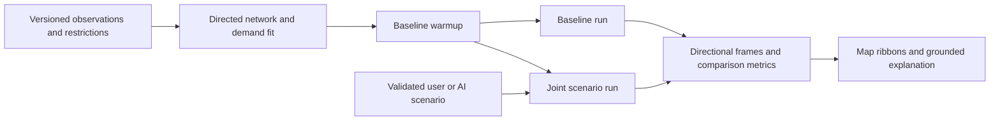

# Make Toronto closures produce credible consequences

**Replace the current traffic-impact calculation with a deterministic, dynamic network simulation, while keeping Mapbox and the existing disruption editor.** Benchmark SUMO’s mesoscopic mode first, behind an engine adapter; evaluate UXsim against the same fixtures if SUMO’s operational cost is excessive. Keep Gemini for interpreting requests, identifying missing assumptions and explaining computed results. Asking an LLM to invent diversion percentages will not solve the present model’s missing demand, queues or intersection constraints. There is also a Queen Street data issue to investigate before increasing simulated congestion: some extremely low counts were observed after the official start of a major closure. A more capable engine fed those counts could still predict little additional impact. This report audits the working tree and primary documentation checked on October 18, 2026; it proposes a redesign, not a calibrated forecast or an implemented replacement.

**The present system redistributes estimates; it does not move a conserved population of trips.** The baseline assigns each road a daily volume, applies one shared weekday or weekend profile, splits two-way traffic equally, and calculates speed from volume divided by assumed capacity. Its curve is `freeSpeed / (1 + 0.15 × ratio⁴)`, with a 4 km/h floor. There is no evolving density, queue, signal phase or downstream receiving capacity. A blocked junction therefore cannot physically prevent traffic entering the road behind it. ([Baseline calculation](/Users/kevinli/htv/src/lib/traffic/model.ts:48))

For a restriction, the rerouter constructs a directed graph, removes fully closed links, and calculates up to three penalized shortest alternatives per direction. Diverted demand comes from the mean traffic at the selected corridor’s first and last segments. A lane reduction retains 55% of baseline flow and halves capacity; a full closure retains none. Alternatives receive inverse-travel-time weights, and their added traffic does not trigger another congestion-aware assignment pass. Trips joining or leaving halfway through a long closure are absent from this demand calculation. ([Graph and alternatives](/Users/kevinli/htv/src/lib/traffic/rerouting.ts:104), [Corridor demand](/Users/kevinli/htv/src/lib/traffic/rerouting.ts:168), [Allocation](/Users/kevinli/htv/src/lib/traffic/rerouting.ts:202))

The recent fixes correctly preserve the input diversion total across alternatives, respect route direction and avoid counting adjacent closures as independent through corridors. **That assignment arithmetic is not network conservation.** Background volumes remain independent estimates on every link; there are no trip identities or complete original routes from which diverted trips are removed. Adding vehicles along a detour can consequently understate or overstate actual network effects. Unroutable demand is reported but never waits in a physical queue. A saved disruption can work exactly as programmed while still producing an implausible result.

AI is not currently responsible for road-closure calculations. Any scenario containing a road restriction uses the local plan. Only event-only scenarios can ask Gemini for route weights and arriving vehicles. The browser refreshes these snapshots in 15-minute demand buckets after a debounce; those requests are not simulation timesteps. ([API behavior](/Users/kevinli/htv/src/app/api/traffic/reroute/route.ts:40), [Refresh behavior](/Users/kevinli/htv/src/components/traffic/use-rerouting.ts:12))

**Queen Street exposes both a demand problem and a display problem.** A diagnostic reproducing a similar York-to-George corridor at weekday 17:45 generated approximately 294 diverted vehicles/hour per direction for a full closure, distributed across three alternatives in each direction. One Richmond segment gained about 212 vehicles/hour, changing its calculated speed from 36.6 to 34.6 km/h. A lane reduction added approximately 95 vehicles/hour there, changing 36.6 to 35.8 km/h. These are illustrations of the current model under specified inputs, not measurements or a reconstruction of the exact saved screenshot state.

The current extract contains a Queen Street West segment with 36 estimated weekday vehicles/day, based on a Queen/Yonge intersection count dated October 17, 2023, and another with 24/day, based on a Bay/Queen count dated July 3, 2025. Other nearby Queen segments carry thousands or tens of thousands. These interior counts do not directly set diversion demand in the reproduced York-to-George example, whose endpoint daily volumes are 9,515 and 4,955; they expose a separate baseline inconsistency. The City announced full Queen closures between Bay, Yonge and Victoria beginning May 1, 2023. **It is plausible that these counts reflect already restricted conditions; the dates alone do not prove the cause.** Do not replace them automatically with larger values. Check movement definitions, matching, historical restrictions and adjacent observations. The 2023 announcement also does not establish the road’s current status; inspect a dated restriction snapshot. ([Current extract](/Users/kevinli/htv/public/data/traffic.json:1), [Official closure announcement](https://www.toronto.ca/news/city-of-toronto-introduces-priority-travel-routes-and-takes-action-to-reduce-traffic-congestion-during-ontario-line-construction/))

Before fitting demand, choose what “Before” means: observed conditions with known restrictions, or a hypothetical typical day with the road open. Mixing observations collected under closures with an assumed open-road baseline makes the comparison ambiguous. Each run should record that baseline choice and its evidence.

The color scale further obscures change. It reaches its maximum “Stop-and-go” category at volume/capacity 0.92, although the speed curve still gives approximately 36.1 km/h from a 40 km/h free speed. Already red roads cannot become much redder, and the label conflicts with the calculated speed. Replace this with one coherent mapping from simulated speed relative to free speed and queue state. Show additional delay or queue growth when comparing scenarios, rather than relying entirely on hue. ([Color thresholds and speed curve](/Users/kevinli/htv/src/lib/traffic/model.ts:11))

**Improve the evidence before making the engine more elaborate.** The built extract has 42,987 links: 12,360 use midblock counts, 7,063 use intersection estimates, 12,796 use nearby-street estimates and 10,768 use class assumptions. These categories are not equivalent evidence. The shared time profiles use 97 weekday and 13 weekend count-days, not that many unique representative locations. The builder reads the volume-only 2020–2024 raw file for those profiles, extrapolates intersection approaches through them, and drops original Centreline junction identifiers before export. ([Profile input and aggregation](/Users/kevinli/htv/scripts/build-traffic.ts:27), [Intersection estimation](/Users/kevinli/htv/scripts/build-traffic.ts:245), [Dropped identifiers](/Users/kevinli/htv/scripts/build-traffic.ts:393))

Rebuild a versioned observation layer preserving survey ID, date, direction, 15-minute interval, movement, vehicle class, source and quality flags. Toronto’s raw turning counts provide left/right/through observations; midblock resources provide directional volume and some measured speeds. Integrate the available volume, speed-volume and classification resources by count identity without double-counting overlapping surveys. A catalogue refresh does not mean every road has a new observation. These surveys constrain demand and turning shares; they do not uniquely identify complete origin–destination trips. ([Intersection dataset](https://open.toronto.ca/dataset/traffic-volumes-at-intersections-for-all-modes/), [Midblock dataset](https://open.toronto.ca/dataset/traffic-volumes-midblock-vehicle-speed-volume-and-classification-counts/))

Retain Centreline junction IDs, then enrich directed links with checked lane counts, access permissions, turn restrictions, free speeds and junction behavior. Grade-separated crossings must not become intersections. Inspect signal timing freshness and applicability rather than assuming the catalogue description guarantees current usable timings. Cache restriction snapshots with age and matching confidence. The City’s transportation data documentation says its real-time Bluetooth feed is not operational, so a free continuous citywide travel-time feed cannot be assumed. ([Centreline](https://open.toronto.ca/dataset/toronto-centreline-tcl/), [Signal timing catalogue](https://ckan0.cf.opendata.inter.prod-toronto.ca/api/3/action/package_show?id=traffic-signal-timing), [Restrictions](https://open.toronto.ca/dataset/road-restrictions/), [City data documentation](https://github.com/CityofToronto/bdit_data-sources#open-data-releases))

**A maintained mesoscopic engine is the strongest next investment.** It models traffic progression and queues without requiring the product to render individual cars. “Mesoscopic” describes simulation resolution; Mapbox can continue displaying the existing ribbons and 3D buildings independently.

| Approach | What it adds | Main cost or limitation | Decision |
| --- | --- | --- | --- |
| Extend the current static assignment | Iterative route costs and better diversion shares | Still lacks physical storage and spillback | Keep only as an explicitly approximate fallback |
| Custom cell-transmission model | Conserved density, downstream supply and queue propagation | Must implement stable numerics, junction allocation, turns and validation | Credible research basis, substantial implementation burden |
| SUMO mesoscopic service | Established network tooling, queues, junction options and rerouting | Native process, network conversion, calibration and careful configuration | First benchmark candidate |
| UXsim service | Compact Python mesoscopic model with congestion and reactive route choice | Verify turn constraints, closure semantics and platoon precision | Benchmark alternative using identical fixtures |
| LLM-generated traffic effects | Fluent scenario descriptions | No guaranteed conservation or causal traffic accuracy | Exclude from numerical engine |

Cell-transmission methods explicitly model traffic through spatial conservation and supply constraints. A point queue alone is insufficient for physical spillback: downstream storage must limit upstream inflow. SUMO’s mesoscopic documentation describes queue and urban-junction options, including optional link-transmission behavior; configure these deliberately because relevant junction-control defaults are not automatically appropriate for downtown Toronto. Pin a release and verify supported features rather than coding against development documentation. UXsim documents its Newell-based mesoscopic mechanism, node constraints and route choice, making it worth testing rather than dismissing. Neither engine has been installed, integrated or benchmarked in this repository. ([Daganzo network model](https://escholarship.org/uc/item/9pz309w7), [SUMO mesoscopic mode](https://sumo.dlr.de/docs/Simulation/Meso.html), [UXsim mechanism](https://toruseo.jp/UXsim/docs/mechanism.html))

**The new processing should compare matched dynamic runs.** Use the following flow; the renderer consumes results rather than deriving congestion itself.

Fit nonnegative, time-binned boundary and internal origin–destination demand to directional counts and turns, with a prior and explicit uncertainty. Do not load every measured link count as a separate stream of newly generated vehicles. SUMO offers demand-generation tools based on observation points, but matching some counts does not establish a unique or accurate trip matrix. Use identical background demand, seed and weather for the baseline and scenario. Start with a buffered downtown district, not the viewport or only the selected street. Monitor blocked boundaries and expand the district when truncation changes conclusions. ([Demand from observations](https://sumo.dlr.de/docs/Demand/Routes_from_Observation_Points.html))

Compile every active disruption into one joint scenario: directed closure permissions, lane/capacity changes, onset, clearance, recovery and driver awareness. Planned closures can legitimately produce less immediate queuing than unexpected incidents because drivers change routes beforehand. Explicit SUMO closure permissions matter; its rerouter documentation describes cases where an unavailable alternative can leave behavior different from the intended prohibition. Vehicles already inside an affected link need a defined treatment, not deletion. Partial road extents require a stable mapping to split engine edges. ([SUMO rerouters](https://sumo.dlr.de/docs/Simulation/Rerouter.html))

Maintain a vehicle ledger: initial vehicles plus generated departures must equal completed trips, vehicles on the network, pending departures and explicitly cancelled trips. Separate attempted departures from admitted inflow. Never discard a queue because its road is full. SUMO can teleport stuck vehicles by default, including after a 300-second wait under documented conditions; disable this for the benchmark where appropriate or expose every such intervention in diagnostics. Rerouting and assignment must use updated congestion costs; decide separately how much advance knowledge planned-closure drivers possess. ([Teleport behavior](https://sumo.dlr.de/docs/Simulation/Why_Vehicles_are_teleporting.html), [Dynamic assignment](https://sumo.dlr.de/docs/Demand/Dynamic_User_Assignment.html))

**Use a service contract that survives changing engines.** Add proposed contracts in `src/lib/traffic/simulation-types.ts`: a versioned request containing network and demand versions, baseline context, Toronto date/time, horizon, weather, seed and joint operations; a job result containing status, provenance, warnings, ledger diagnostics and directional frames. Each frame should distinguish speed, inflow, outflow, density, queue, travel time and blocked access. Return network delay, completed trips and pending demand alongside local road changes. Units must be explicit. SUMO documents edge/lane measures, but their definitions and aggregation windows must be mapped deliberately. ([Traffic measures](https://sumo.dlr.de/docs/Simulation/Output/Lane-_or_Edge-based_Traffic_Measures.html))

Introduce an adapter such as `src/lib/traffic/simulation-client.ts` and proposed `/api/traffic/simulations` job endpoints. A separate Python/native worker should run SUMO through its supported interface; the Next.js route should validate, submit, cancel and retrieve jobs rather than host long simulations inside request execution. Preserve the old `/api/traffic/reroute` behind a feature flag during comparison. Replace `useRerouting` with a cancellation-safe simulation hook, and make `traffic-overlay.tsx` interpolate engine frames. Keep map geometry and GPU animation independent from simulation timesteps. ([SUMO Python interface](https://sumo.dlr.de/docs/TraCI/Interfacing_TraCI_from_Python.html))

Do not translate the new engine back into additive `perDisruption` impacts. The existing comparison code sums those contributions, but congestion interactions are nonlinear. Simulate all active operations together; if attribution is needed, run separate leave-one-out comparisons and explain that their effects need not sum to the combined effect. ([Current additive comparison](/Users/kevinli/htv/src/lib/traffic/comparison.ts:17))

Initial engineering targets are sparse 15–30-second output frames, a 30–60-minute comparison horizon plus validated warmup and recovery, and aggregated renderer updates around 1–2 Hz. These are proposed settings, not demonstrated performance. Cache keys must include network, demand, engine and scenario versions. Reuse snapshots only if the pinned engine supports verified state restoration; otherwise rerun warmup with a fixed seed. Seeking, changing dates or editing weather must select a valid result or trigger a new run, not reuse incompatible state.

**AI should reduce scenario friction and explain evidence.** Gemini can turn “close Queen from York to George after 5 PM” into a draft, call the existing street resolver, ask whether all lanes or one direction are blocked, and summarize computed queue locations and delays. Validate identifiers, connectivity, timing, units and ranges in application code. Structured JSON only constrains shape; Google explicitly warns that semantic correctness still needs validation. Remove event route weights and hourly vehicle totals from unconstrained LLM judgment. ([Gemini structured output](https://ai.google.dev/gemini-api/docs/structured-output))

Event demand should instead expose attendance, auto share, occupancy and arrival/departure curves, with low/base/high assumptions and separate ride-hail legs. Weather can modify speed and capacity through documented assumptions; avoid silently adding a second demand penalty. The existing weather curves are not Toronto calibration. Train a learned surrogate only after collecting aligned observations or validated engine runs, with a declared training domain and fallback outside it. ([FHWA event demand](https://ops.fhwa.dot.gov/publications/fhwaop04010/chapter5_03.htm), [Weather impacts](https://ops.fhwa.dot.gov/weather/roadimpact.htm))

**Build one Queen Street vertical slice before expanding citywide.** First audit the suspicious counts and choose the baseline context. Export a small buffered network with checked Queen, Richmond and Adelaide directions and junctions. Benchmark SUMO mesoscopic mode on three known fixtures: a bottleneck whose finite queue spills upstream, a closure with a legal alternative, and an inaccessible destination whose departures remain accounted for. Then run the real Queen corridor with matched background demand and show baseline/scenario speed, queue growth, additional delay and recovery. Add event and weather integration after that comparison works.

The first acceptance gate is physical correctness: vehicle balance, legal turns, no negative or overflowing occupancy, reproducible seeds, and remaining delay after clearance until queues dissipate. The second is evidence: hold out counts and travel times from calibration, report coverage and error by direction and period, and test demand/capacity sensitivity. The third is usability: measure P50/P95 job latency and map interaction frame time on the target Mac. No engine speed claim from another project establishes this app’s performance. The current 157 passing tests establish software regression coverage, not real-world traffic accuracy. ([FHWA calibration and validation guidance](https://ops.fhwa.dot.gov/publications/fhwahop13015/sec4.htm))

The defensible product claim is an explainable comparison under stated, testable assumptions. A successful redesign can reveal substantial closure effects when demand and bottlenecks support them—and explain a small effect when a road was already restricted, lightly used or served by spare alternative capacity. That distinction is more useful to officials, organizers and residents than forcing every saved closure to create a dramatic red zone.
